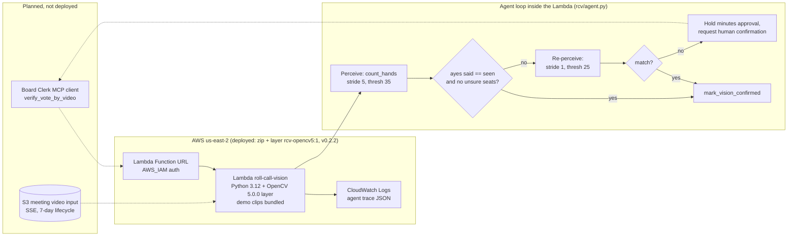

# Roll Call Vision: architecture

OpenCV 5 pipeline per seat ROI: grayscale → Gaussian blur → absdiff vs a median baseline from the first 1.5 s of the meeting video → binary threshold → morphological open → external contours → largest-area test; dark-fraction occlusion flag. Per-frame votes aggregated over the vote window (>=50% of frames = aye; 20–50% = unsure).

Live endpoint (IAM): `https://hj6wfy2lilbbllikwriblbsx3m0thfif.lambda-url.us-east-2.on.aws/`, a Function URL with AWS_IAM auth (not public). Deploy path is zip function code + OpenCV layer (no container / ECR). Deployed today: the Function URL, the Lambda with the OpenCV 5 layer, and CloudWatch Logs. The demo clips ship inside the zip. The S3 input, its lifecycle rule and the Board Clerk client are planned and not deployed.
